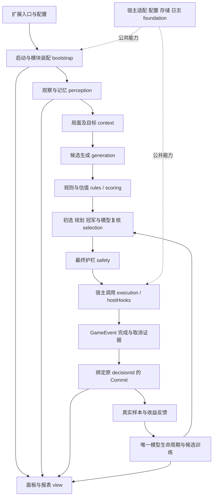

# 无名AI结构调整与联调交接稿

整理日期：2026-11-05。修改批次：2026-11-04。基线：`main@cd3f23f628ed5b41f498d78688d551f3248e4e80`。

**当前结论：B1–B4 所列结构调整已经落地，B5 实机验收部分完成。2026-11-05 已修复 B5-F07，真实宿主的正常技能、两类取消及响应隔离共 13 项通过；换局、长局和训练/A/B 等仍待验收，分支继续保持草稿。**

**后续实机进展：**旧事件晚完成/晚取消共 8 项检查通过，新事务未被提交或取消；真实 game.over 后通过游戏“重新开始”进入新局，8 名玩家中旧 pending 为 0。此结论只覆盖标准页面重载。终局后原事件等待未返回，同页继续运行时的终局回调隔离仍待验证，不能将 B5 整体关闭。

本稿汇总架构审查、迁移、执行与学习一致性修复及实机结果。分支独立保存这批改动，现有 main 和已安装游戏保持原样。问题编号沿用原工作记录。

## 1. 最初要解决什么

扩展入口、决策、模型、面板和跨模块协作混在少数大文件中。定位问题时，需要先分辨代码归属、状态由谁保存，以及动作究竟有没有真实执行。本次先明确整体链路，再按职责拆开实现，旧入口保留兼容转出，避免其他读取方断开。

架构评判标准：**修改一个环节时，能找到唯一负责的实现，并证明上下游接口、状态及数据仍对得上。** 文件变短、目录变多只说明迁移规模，不能证明架构质量或 AI 变强。

## 2. 调整前后对照

| 环节 | 调整前 | 当前分工 | 审查时看什么 |
| --- | --- | --- | --- |
| 扩展启动 | extension.js、precontent、score/index 分担多种初始化与注册 | 外壳初始化、旧规则注册、score/bootstrap 生命周期与公开接口分开 | 重复安装、卸载、重装是否对称 |
| 主动决策 | engine.js 串联局面、候选、估值、仲裁及大量副作用 | context → generation → rules/scoring → selection → safety → execution | 每一步输入输出是否一致；bestAction 仍是协调入口，并非已完全消除复杂性 |
| 候选评分 | 枚举、卡牌/装备/技能估值及缓存交织 | generation 枚举，三个 scoring 模块估值，candidateValuation 持有缓存 | 没有重复算法或另一份缓存状态 |
| 实际执行 | 调用宿主函数与记录决策容易混淆 | hostHooks 调用宿主；网关等待 GameEvent；事务确认后执行延迟副作用 | 函数返回、事件完成、动作生效三者不能混为一谈 |
| 记分与日志 | 引擎同时持有台账、事件处理、日志和结算 | scoreLedger、scoreEvents、decisionRecords、playerActionLog、gameSettlement | 状态各有唯一负责人，旧查询仍读同一份 |
| 技能逻辑 | skills.js 混合扫描、画像、建议和显示 | skillSourceTags、skillProfiles、skillAdvice、skillPresentation | 原 skillTags 工具保留，不因相似命名被覆盖 |
| 模型管理 | modelState 混合状态、训练、快照、回流和界面提示 | modelLifecycle、candidateTraining、modelSnapshot、model/bootstrap、view/model | A/B 候选槽和生命周期只有一份 |
| 配置与导出 | foundation/io 同时编排业务数据与创建面板 | bootstrap 汇总数据，foundation 执行通用下载，view 显示面板 | 配置键、导出读取方与兼容入口是否仍可用 |

## 3. 当前整体逻辑

下图表达业务协作关系，不是完整 import 图；存在兼容、注入与全局注册读取，不能只靠静态箭头证明可达。

## 4. B1–B5 完成情况

| 阶段 | 交付内容 | 当前状态 |
| --- | --- | --- |
| 前期审查与工具 | 固定 Noname-AI 源码基线；检查真实 import、调用和数据依赖；安装 mattpocock-skills 1.3.2；建立本地问题记录 | 已有审查和工具记录；旧 Skill 名称部分已调整，以宿主实际提供的名称为准，不宣称最初要求的八个名称均可直接调用 |
| B0 全量盘点与迁移表 | 固定当时 314 个文件快照，登记职责、读取方及迁移目标 | 历史快照；“待确认”不等于当前未迁移，也不代表逐函数认证通过 |
| B1 职责与入口归位 | 决策选择、响应、拼点归位；旧路径兼容；生命周期与公共接口梳理 | 所列结构项已实施，异步安装中卸载的竞态未验收 |
| B2 配置、数据与界面分离 | 配置档案、业务导出、通用下载、校准及导出面板分开 | 已实施；一键导出实机成功；导入还原尚未验收 |
| B3 决策链与旧规则拆分 | 生成、估值、仲裁、执行、观测、台账、日志、结算及旧宿主规则分别归位 | 所列结构项已实施，仍需补齐实机覆盖 |
| B4 模型结构 | 唯一状态机、候选副本训练、快照校验、冠军/局末学习协作、显示分开 | 结构已实施；真实手动训练及 A/B 全流程未验收 |
| B5 整合与实机 | 兼容入口、面板、宿主动作、事务与收益反馈联调 | B5-F07 已修复并通过受控实机检查；整体验收仍开放 |

## 5. 已实施的一致性修复

| 问题 | 修改后行为 | 证据及限制 |
| --- | --- | --- |
| 冠军提权配置 0 被默认值吞掉 | 0、缺省及无效/非正数关闭提权，有限正数启用 | resolveChampionBoost 及对应行为测试；不代表所有冠军策略均已验收 |
| 未执行候选与真实执行样本混用 | Commit 后只记录最终动作，不把候选估值当成已执行结果 | 来源与反馈身份测试；未清洗已有数据 |
| 反馈按玩家/动作宽泛匹配 | 新样本增加 decisionId，去重键包含该编号；反馈精确匹配且不重复回填 | 没有 decisionId 的旧反馈不再猜测匹配；旧样本不追溯改写 |
| 函数正常返回就可能记为成功 | 等待宿主事件结束，并检查取消与证据条件 | 基础事件测试通过；下列“不触发通知的取消”仍有缺口 |
| B5-F01 卸载删除共享接口 | 只恢复本桥拥有的成员，保留其他模块接口及后来写入 | 重复安装、卸载恢复、重装及接口读取实机通过 |
| B5-F02 方法扫描触发 getter | 读属性描述符，跳过访问器 | 实机恢复到 510 个方法；getter 不执行断言通过 |
| B5-F03 面板竖排错乱 | 校准、导出复用现有面板样式入口 | 可读、可关闭；三个导出包实际生成五个文件 |
| B5-F04 护栏误判目标缺失 | 补齐 game 宿主导入 | 修复前 44/44 被 TARGET_MISSING 拦截，新局修复后 16 次检查、0 次拦截；不是对全部红线正确性的证明 |
| B5-F05 快照与反馈断开 | 执行前快照带 tx.id，postCheck 补齐 game/_status 导入 | 独立真实用牌样本按同一编号回填一次收益 |
| B5-F06 旧事件串写新事务 | 用牌、技能、结束选择绑定原事务编号；旧完成/取消/报错不得操作后来事务 | 修复前专项 8/71 断言失败；修复后网关 80 项通过，含换局与超时；完整实机覆盖未完成 |
| B5-F07 静默取消误 Commit | 临时观测单个事件 cancel，保留原行为；结束后恢复，只取消原编号事务 | 新增回归修复前 3/88 失败，修复后 88 项通过；真实两类取消均不执行内容、不 Commit，原方法恢复 |

## 6. 验证结果：通过与未通过分开

### 自动回归

2026-11-05 修复后最后一次 `npm test`：主门禁 1899；AOE 31、追踪 24、事务 33、配置 130、网关 88、质量 57 项断言通过。既有隐藏信息欠账 8 项、行为欠账 1 项保留，新增基线回归为 0。日志见 [cancel-fix-regression.log](evidence/cancel-fix-regression.log)。

### 隔离实机

实际运行核心为 **1.11.7**；不能由本地目录名认定为 1.11.6，也不能将结果视作 1.11.6.1 兼容验收。

- 扩展加载、重复安装、卸载恢复、重新安装通过；四个面板入口及校准 stats 在重启后存在。
- 校准和导出面板可用；一键导出生成三个包、五个文件。导入还原未完成。
- 真实用牌：1 次 Commit、1 条 source=real 样本、同 decisionId 回填一次反馈。编号 `dtx_mw2r8afx_5`。单个样本不能证明整个闭环正确。
- 正常技能受控场景：函数返回时不提前 Commit，技能内容实际执行，原事务只提交一次。编号 `dtx_mw2rz56d_2`。
- 历史取消场景曾失败（B5-F07）；2026-11-05 修复后，同类真实宿主组合场景 13 项通过：正常技能、普通取消、静默取消、原方法恢复及响应不冒充主动动作。Commit 为 1，样本数 1→1，errors=[]。受控回调只计数，不是自然选牌或完整训练链验收；真实换局仍待验证。
- 第一轮 3 次 mismatch、1 次 expiry 缺少逐条动作记录，无法事后还原原因；不能直接归因为 B5-F06。五秒 TTL 未调整。

## 7. 待解决问题，按优先级排列

| 优先级 / 编号 | 人话说明 | 下一步验收 |
| --- | --- | --- |
| P1 / B1-F01 | 模型要集火/保护计数，提供方却给消息数和布尔值 | 定义计数含义及来源，验证 112–113 维，评估旧权重兼容 |
| P1 / B1-F02 | 模型要一/三回合收益，提供方却给回合数和进攻倾向 | 定义收益单位及验证办法，再处理 114–115 维 |
| P1 / B1-F03 | 模型要手牌/装备价值，提供方却给净张数等统计 | 明确唯一估值来源及归一化，验证 116–117 维 |
| P1 / B1-F04 | 模型要认知置信度/冲突数，日志却主要给分级与介入统计 | 明确概念和权威接口，验证 118–119 维 |
| P2 / B1-L01 | 插件正在异步安装时卸载，状态和资源是否一致尚不清楚 | 阻塞安装后卸载，核对迟到回调和清理 |
| 待验收 / B4-V01 | 真实手动训练、A/B 换入恢复、晋升丢弃未走完 | 在隔离环境逐条验证，保持唯一状态机 |
| 待验收 / B5-V01–V03 | 响应、换局、长局、导入还原及输出扩展名兼容 | 有具体动作、事务和数据往返证据再关闭 |

**B5-F07 已关闭本次复现：**历史测试调用 `cancel(true, null, 'notrigger')` 时核心 finish 但不设置 `_cancelled`，旧网关误提交事务 `dtx_mw2rz6pt_3`。测试已纠正为检查内容次数、事务及样本结果，不再要求本体改变字段；修复后 13 项受控实机检查通过。

**修复已实施并复验：**扩展等待事件前临时观测该事件 cancel，保留参数、this 和返回值；确认时拒绝已调用 cancel 的事件，只处理原事务；结束后恢复自身包装。多个确认者共享观测，不改本体原型、不覆盖后来接管该成员的模块。不能以受控场景通过声称全部取消时序已覆盖。

**已撤销误报：**B2-F01 原称 `_exportAllThree` 未定义；核对基线与当前实现后发现按钮采用内联顺序调用，且实际导出成功。该问题撤销，没有添加不存在的函数。

## 8. 数据与兼容边界

- 旧路径保留兼容转出，业务状态只由新实现持有，避免同名两份状态。
- 结构迁移不改网络维度、既有权重、djsc_model_state v2 或校准历史存储键；四组特征不擅自补新语义。
- 前期 P1 修复增加 decisionId 元数据并收紧反馈匹配，改变新样本去重/回填条件；不能笼统描述成“全部数据行为未变”。
- 没有清除、覆盖或追溯修正已有训练数据。历史样本是否受过串写影响，现有证据无法判断。
- 游戏本体与正式安装扩展保持原样；测试写入限定在隔离环境。

## 9. 后续执行顺序

1. B5-F07 本次受控复现已关闭；后续保留两类取消不 Commit 的回归约束。
2. 受控晚结算和标准 UI 重开已通过；继续自然响应、同页终局等待和长局，保存动作、事务编号和拒绝原因。
3. 验证真实训练、A/B 和导出导入；完成 B5 的结构连接验收。
4. 再定义四组特征语义与数据版本策略，避免在结构调整中夹带模型行为变化。

本稿只归档当前改动与方案，以上未完成项不会因创建 PR 自动实施或关闭。

## 10. 开发时怎么使用这套结构

需求说明 → 设计接口与状态归属 → 按迁移表拆任务 → 实施 → 对应行为测试 → 固定基线审查 → 独立分支 PR。

模块接口设计使用 codebase-design；异常和性能问题用 diagnosing-bugs；需要行为回归时用 tdd；按固定基线审查用 code-review；PR 文稿用 pr。沿用项目既有规范，旧 Skill 名称以插件现行入口为准，不重复安装另一套。

每次修改先回答：谁调用、谁持有状态、何时允许副作用、怎么判定实际生效。发现问题同步登记编号、证据、修复/待验状态，不用“测试通过”覆盖已知实机失败。

## 相关文稿与证据

- [问题表（含历史处理记录）](issue-tracker.md)
- [全量盘点迁移表（历史快照）](migration-plan.md)
- [测试摘要与实机摘录](evidence/validation.md)
- [原受控宿主场景脚本](evidence/host-scenarios.js)
- [模块职责索引](../../../score/README.md)
- [主动决策交接契约](../../../score/decision/CONTRACTS.md)

中文审查备注：本分支是可审查的阶段成果；草稿状态表示保留已知缺陷与未验收项，不表示已经批准合并或替换现有版本。
