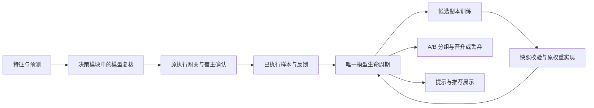
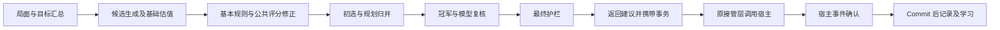

# 无名AI 模块职责与整理进度

本文件区分当前实现与后续整理目标；目录归类不代表整条运行链已经实机验收。

## B5 当前验收状态（2026-11-04）

**第五轮进展：**真实宿主晚完成/晚取消 8 项通过；真实终局后从游戏界面重新开始，新局 players=8、over=false、oldPending=0。只覆盖标准重载方式，未将终局等待未返回、同页复用和长局等场景标为通过。业务实现未新增修改。

**2026-11-05 最新：**B5-F07 已修复，扩展临时观测单个事件 cancel 并在完成后恢复，不改核心原型。网关 88 项及完整回归通过；真实宿主的正常技能、普通/静默取消、响应隔离共 13 项通过，Commit=1、样本数 1→1。自然场景、换局、长局、训练/A/B 和导入还原仍待验；以下为历史各轮记录。

最新第三轮实机发现 B5-F07：核心 `cancel(..., 'notrigger')` 会 finish 但不设置 `_cancelled`，当前网关误判成成功。正常技能完成与一次 Commit 已通过；取消断言失败后停止，响应和换局实机未验收。该问题尚未修复，不能以此前 Node 通过宣称 B5 完成。

第二轮新增 B5-F06：执行网关等待宿主事件时绑定原事务 id，完成、取消、失败后均先核对，避免旧动作操作后来动作或新局的事务。用牌、技能、结束选择入口显式传 id，旧三参数同步取消接口保持兼容。网关 80 项及完整 npm test 通过；真实游戏复验仍待进行，没有宣称从旧聚合计数还原了三次不匹配原因。

已完成首轮隔离实机联调，实际核心 1.11.7：仓库扩展加载，重复安装/卸载/重装成功；四个面板入口和校准 stats 在重启后保留；扫描返回 510 个方法。校准、导出面板可读可关闭，一键导出三个包、五个文件到测试沙箱。

已修复共享调试接口被卸载删除、DOM getter 扫描异常、两处面板定位、护栏缺少 game 导入、执行快照缺少事务编号及 game/_status 导入。独立新对局观察到 1 次 Commit、1 条真实样本、同 decisionId 的 1 次反馈回填，无 Commit 异常；不将一个样本等同于全动作覆盖。

最新 npm test 主门禁 1899 项及其余六组检查通过。B5 尚未完成技能/响应/取消/换局、真实手动训练和 A/B 全流程、导入还原；四组特征语义问题仍开放。历史章节中的“未实机联调”和 1886 项为当时记录，最新状态以本节及 `../DEV_GUIDE/architecture-review/2026-11-04/issue-tracker.md` 为准。

## 全局职责

| 目录 | 应负责的事情 | 不应承担的事情 |
| --- | --- | --- |
| bootstrap | 引擎安装、卸载、模块暴露及就绪状态编排 | 卡牌评分与训练算法 |
| perception | 观察行为、记忆、对局记录与统计 | 决定拼点或响应时出哪张牌 |
| cognition | 局面推理、意图分析与解释 | 直接执行游戏动作 |
| knowledge | 卡牌、技能等静态知识 | 保存本局可变状态 |
| decision | 生成可选动作、评分、策略协调、安全检查与执行确认 | 模型参数训练与界面绘制 |
| model | 特征、预测、权重、训练和校准 | 绕过执行确认创建真实执行反馈 |
| foundation | 宿主适配、配置读取、存储、日志与公共运行设施 | 某张卡或某个武将的策略 |
| view | 面板、按钮、报表及其展示逻辑 | 在绘图过程中决定 AI 动作 |
| plugins | 沿用现有插件机制，声明安装依赖 | 重建另一套并行生命周期体系 |
| verification | 扩展自身的诊断与自检 | 替代真实对局验证 |

## 已落地的归位

- `selection/candidateSelection.js` 位于 `decision/` 下，负责动作初选及规划结果归并。
- `response/responseAI.js` 位于 `decision/` 下，负责响应出牌策略。
- `response/compareAI.js` 位于 `decision/` 下，负责拼点选牌；它不是 AI 对比统计。
- `state/actionCandidate.js` 继续定义动作记录、身份比较与优先级契约，不承担整条决策流程。
- 上述三个实现的旧文件路径只转出新模块；不得在兼容文件里新增实现或单独保存状态。
- 引擎、启动编排、模块暴露和模块清单使用新路径；旧调用方仍可使用兼容路径。

以上三个 `selection/`、`response/`、`state/` 路径均相对于 `score/decision/`。

## 接口与状态的维护规则

- 修改职责时先找到所属实现；同一实现只保留一份，旧路径只做兼容转出。
- 更新路径必须同时检查静态 import、动态 import、注册清单与测试中的源码读取。
- 安装、卸载及单例状态由实际实现持有，兼容入口不得再次安装。
- 配置键、存储位置和训练数据格式本次保持原样。
- `registry.js` 继续承担既有接口挂载功能；不得把“当前有注册器”误写成“重复挂载已全部消除”。

## 仍需整理

### B3 收尾与 B4 模型结构（最新本地状态）

B3-A01、B3-A02 所列结构拆分已完成：估值及缓存、记分台账、实际事件记分、宿主钩子、日志、结算、观测和技能解析各有实现负责人。真实宿主验收仍归 B5，未标记完成。

| 板块 | 目前的实现归属 |
| --- | --- |
| 候选枚举、去重、顺序 | decision/generation/scoredCandidates.js |
| 技能/卡牌/装备基础估值 | decision/scoring/skillCandidateScore.js、cardCandidateScore.js、equipCandidateScore.js |
| 估值缓存与记分状态 | decision/scoring/candidateValuation.js、scoreLedger.js、scoreEvents.js，各持有自己的唯一状态 |
| 宿主钩子与卸载取消句柄 | decision/execution/hostHooks.js |
| 日志、观测与局末编排 | decision/records/decisionRecords.js、decision/feedback/decisionObservations.js、decision/settlement/gameSettlement.js |
| 技能扫描/画像/战术/显示 | decision/skills/skillSourceTags.js、skillProfiles.js、skillAdvice.js、view/report/skillPresentation.js |
| 唯一模型生命周期与 A/B 候选槽 | model/state/modelLifecycle.js；net/modelState.js、net/modelHotSwap.js 保留兼容 |
| 候选副本训练 | model/train/candidateTraining.js；不创建独立 A/B 状态 |
| 完整快照转换和结构护栏 | model/weights/modelSnapshot.js；网络维度仍只读 MODEL_SCHEMA |
| 训练后的冠军回流、局末学习协作 | model/bootstrap/championLearning.js、gameLearning.js |
| 提示与推荐文本 | view/model/trainingFeedback.js、trainingRecommendation.js |
| 校准历史状态 | model/calibrate/calibrationHistory.js；校准面板只读取，不另存一份 |
| 模型公开接口装配 | bootstrap/modelStateInterface.js、championLearningInterface.js |

旧入口导出、存储键、状态版本、样本筛选和标签、回流顺序均保持原样。`djsc_model_state` 仍为 v2，旧热更数据迁移逻辑没有重写；没有清理真实训练数据或修改模型参数。
原 `decision/skills/skillTags.js` 是已存在的另一组标签工具，内容保留；源码扫描新模块使用 `skillSourceTags.js`，二者不因名字相近而被覆盖或合并。
本轮 engine.js 为 1678 行，技能公共入口 skills.js 为 40 行；旧模型状态入口为 2 行，实际生命周期实现为 573 行。行数用于定位迁移规模，不作为架构质量或性能指标。
最终 npm test 通过：主门禁 1886 项断言，AOE、追踪、事务、配置、执行网关和质量基线均通过；静态引用扫描无导入环。未进行真实游戏联调，未清除任何原有行为/隐藏信息技术债。
B1-F01–F04 四组特征语义问题已在 B4 再次核对为“需要定义/版本兼容设计的行为变更”，本次结构迁移不擅自给缺失字段填新值，问题仍开放；不能宣称模型输入问题已解决。

### B3：主动决策链与旧宿主规则分段

| 环节 | 实现位置（相对于 score/decision） |
| --- | --- |
| 局面、性格、团队、预测汇总 | context/decisionContext.js |
| 目标分缓存与集火/风格/收割选择 | context/targetContext.js |
| 技能、卡牌、装备、结束候选枚举与去重 | generation/scoredCandidates.js；基础估值在 scoring 的三个 CandidateScore 模块 |
| 基本卡牌/技能/装备/判定/目标规则 | rules/basicRules.js |
| 公共收益修正、方向检查及职责优先级 | scoring/candidateScoring.js |
| 初选、规划及候选对象归并 | selection/candidateSelection.js、plannedSelection.js |
| 原模型观测、冠军策略和 DeepThink 调度 | selection/modelReview.js |
| 护栏接入与红线/冷却/拦截状态 | safety/finalCandidateGuard.js、modelGuard.js |
| 规则价值计算（不是神经网络） | utility/deepValue.js |
| 延迟效果关联事务 | execution/decisionEffects.js |
| 已执行样本记录及收益回填连接 | feedback/executedLearning.js |

`bestAction()` 从约 2144 行缩为约 519 行，保留缓存、顺序调度、结果封装和原观测回调；不是把整个 engine.js 宣称为纯调度模块。
候选生成只枚举和收集，基础估值由独立模块返回；估值缓存与真实事件动量各自有唯一持有方。缓存失效、特征提取预算、冠军启用条件和执行后学习顺序保留。
护栏面板归 `view/dashboard/guardPanel.js`，旧模型目录下的 modelGuard/deepValue 只做兼容转出，统计/冷却没有第二份。

旧宿主 `js/content/precontent.js` 从 790 行缩为 52 行，仍先做版本检测和卡牌优化，再依次注册 `js/content/legacy/startupSkills.js`、`globalRules.js`、`identityRules.js`。十一组技能名、注册顺序和异步回调类型保持不变；这些是宿主适配规则，不冒充决策引擎的另一套执行流程。
响应、弃牌和拼点继续使用现有 `decision/override/respond.js`、`discard.js`、`compare.js` 专属宿主入口及同一个执行网关，没有为了目录整齐再包装一层。

验证：最终 `npm test` 通过；旧技能注册、旧路径共享状态、主链顺序、Commit 前不执行/重复 Commit 不重复记录均有断言。首次 AOE 源码位置检查在迁移后失败，已同步至真实候选模块后通过。静态词法引用扫描未发现导入环。
原有隐藏信息技术债仍为 8 项，只同步其中两项的迁移路径，没有通过迁移或修改基线把它们消除；原有行为欠账 1 项，没有新增回归。
B3 上述收尾及 B4 模型结构整理现已落地，详细位置见本页最新状态；B5 真实宿主联调尚未完成，不能称整体项目已经验收。

### B2：配置、校准展示与数据导出归位（本地实施）

| 职责 | 唯一实现位置 | 旧入口 |
| --- | --- | --- |
| 配置方案的快照、切换与保存 | foundation/config/profiles.js | cognition/profile/profiles.js 仅转出 |
| 校准趋势面板与原有历史快照 | view/dashboard/calibratorPanel.js | model/calibrate/calibratorPanel.js 仅转出 |
| 通用下载、时间戳 | foundation/io/download.js | 经原 export.js 继续转出 |
| 多业务模块诊断数据汇总 | bootstrap/dataExport.js | foundation/io/export.js 仅转出 |
| 训练包/备份包、自动导出和文件读写 | bootstrap/dataTransfer.js | foundation/io/exportAll.js 转出原有名称 |
| 导出中心界面、按钮、结果展示 | view/dashboard/exportPanel.js | 同上，加载时保留原有界面接口挂载 |
| v2 单文件合并导出及还原 | bootstrap/mergedDataExport.js | foundation/io/mergeExport.js 仅转出 |

数据编排通过结果通知连接导出面板，不反向导入面板。现有引擎加载和动态面板入口同步使用新位置；兼容入口不另存一份状态。
校准历史在 B4 已从面板移入 model/calibrate/calibrationHistory.js；算法仍在 model/calibrate，数据键与格式保持不变。
诊断快照、蒸馏/完整训练包、全量备份与 v2 合并包是不同格式，继续共存，不按名称强行合并。
`无名AI_profiles`、`djsc_calib_history_v1`、`djsc_auto_export_v1`、输入输出目录、样本筛选及还原规则保持原样。
本地问题表见 `../DEV_GUIDE/architecture-review/2026-11-04/issue-tracker.md`（相对 current-source 根的上级工作区），已登记 B1 特征字段不匹配与尚未完成的验收项；迁移完成不代表这些问题已修好。
本批一次 `npm test` 通过，覆盖新旧入口同一性、配置共享和训练包格式；未验证浏览器实际下载、备份还原或真实游戏界面。

### B1 第三项：五组补全功能归位

原 `foundation/runtime/missingModules.js` 只保留旧路径转发；`bootstrap/legacyFeatureInterfaces.js` 负责装配。旧算法、字段与状态分别归入以下模块，以 `legacy*Features` 明确标识兼容实现：

| 旧对象 | 实现与状态归属 |
| --- | --- |
| opponentPredict | model/predict/opponentPredict.js |
| teamBroadcast | perception/team/teamBroadcast.js |
| multiturn | decision/strategy/multiturn.js |
| economy | decision/resource/economy.js |
| cognitiveLog | cognition/log/cognitiveLog.js |

本次是结构归位，不是新旧算法合并。引擎仍按原顺序将正式方法与旧特征方法装配在一起；旧路径不会创建另一份状态。
发现旧特征字段与读取方存在差异：团队返回 hasFocus/messageCount，特征读取 focusCount/protectCount；规划返回 turns/aggression，特征读取 r1/r3；经济返回 cardBalance，特征读取 handValue/equipValue。正式认知统计也不直接提供旧 confidence/conflicts 字段。这些属于原有模型输入语义问题，本批不借迁移改变特征值或训练格式，后续必须单独设计兼容方案。

### B1 第二项：启动与插件分工

| 事项 | 唯一负责人 |
| --- | --- |
| 主引擎钩子的安装、卸载与结算监听 | bootstrap/lifecycle.js；引擎提供具体实现 |
| 插件注册、依赖排序、插件接口及插件自身卸载 | foundation/runtime/plugins.js 与 plugins/index.js |
| 判断主引擎已经可用 | enginePlugin 读取实际安装状态；不代为安装 |
| 调试桥和面板守护的创建与取消 | panelPlugin |
| 一轮插件装载的启动广播 | scan；完整卸载后允许新一轮广播 |

重复调用已安装插件不会再次执行 onInstall。卸载扩展不伪装成 game:end，真实对局结束广播仍使用原有公开接口。本轮保留原有“装载时广播启动”的语义，未将它改成另一套逐局事件机制。
此项尚未完成真实游戏内的禁用、重新启用联调；异步插件安装尚未完成时的并发卸载竞态也不在本批验收范围。

### B1 第一项：引擎查询连接（已实施，待最终宿主联调）

- 引擎继续提供旧查询入口；B3 收尾后安装状态归 hostHooks，分数归 scoreLedger，决策日志归 decisionRecords，查询读取其唯一实时状态。
- `foundation/runtime/engineQueries.js` 只接收四个查询函数；健康检查与战报通过它读取实时数据。
- 未连接时显示未安装/空记录；连接后不复制或缓存对局数据，避免换局后读到旧数组。
- 健康检查和战报不再直接反向导入引擎；这不代表所有跨层依赖都已处理完。

- `bestAction()` 已按环节调度；引擎剩余性格分析、缓存失效和公开接口装配并不等于全部业务职责都集中在同一函数。
- `js/bootstrap/publicInterface.js`、`bootstrap/moduleExposure.js` 与业务模块自挂载之间，尚需逐个明确接口负责人。
- 观察、认知、模型与决策之间的反向依赖尚未完成全量审查。
- 最终验收仍需覆盖加载、卸载、重新加载，以及真实动作到学习反馈的完整链路。
